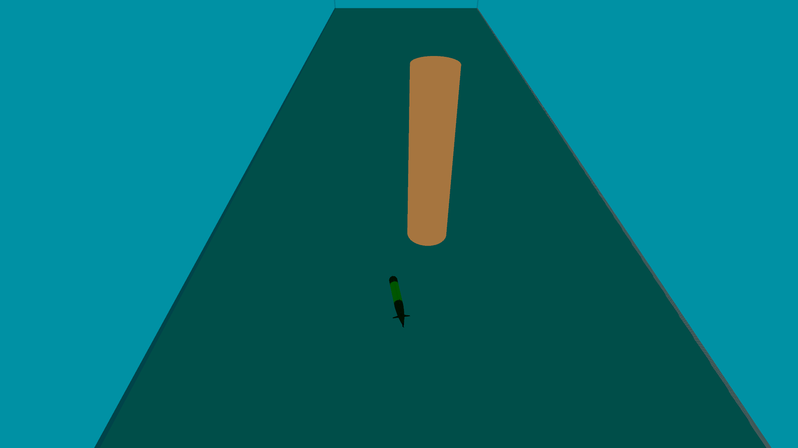

# Collision avoidance 3D per Tethys

Progetto di tesi e tirocinio di **Federico Paoliani**: navigazione locale ed evitamento degli ostacoli per il veicolo subacqueo **Tethys LRAUV**, con **ROS 2 Humble**, **Ignition Gazebo Fortress** e **C++**.

Il planner si ispira al Vector Field Histogram: combina cinque sonar simulati in un istogramma sferico **36 × 18**, valuta corridoi percorribili e waypoint locali, quindi genera comandi per pinne e propulsore. La validazione presentata è svolta **in simulazione**.

## Guarda la dimostrazione

**[Apri o scarica il video MP4](video_finali/Manovra_Collision_Avoidance_Tethys.mp4)** · circa 20 secondi · 1080p · riproduzione **2×** · senza audio.

Il video mostra avvicinamento, deviazione, superamento e ripresa in uno scenario dimostrativo con **un solo pilastro**. È distinto dai sei mondi della campagna sperimentale. [Dettagli della demo](progetto/ros2_tethys/presentazione_tesi/LEGGIMI.md).

## Esplora il progetto

| Materiale | Collegamento |
|---|---|
| Tesi definitiva | [Leggi il PDF](tesi/L31_paoliani_tirocinio.pdf) |
| Codice ROS 2 e risorse Gazebo | [Workspace](progetto/ros2_tethys/) |
| Funzionamento del sistema | [Guida tecnica](documentazione/PROGETTO.md) |
| Struttura del codice | [Diagramma UML delle classi](documentazione/uml/README.md) |
| Preparazione e avvio su Ubuntu | [Istruzioni](documentazione/AVVIO.md) |
| Sei scenari definitivi | [Mondi, parametri e comandi](inventario/SEI_SCENARI.md) |
| Risultati delle prove | [Tabelle complete](risultati_finali/RISULTATI_TEST.md) · [Grafici](risultati_finali/grafici/) |
| Limiti di riproducibilità | [Note](documentazione/RIPRODUCIBILITA.md) |
| Ambiente del PC originale | [Versioni](inventario/AMBIENTE.md) |
| Provenienza e integrità dei file | [Inventario](inventario/FILE_PUBBLICATI.csv) · [Preparazione](documentazione/PUBBLICAZIONE.md) |
| Componenti di terzi | [Attribuzioni e licenze](THIRD_PARTY_NOTICES.md) |

La tesi definitiva è disponibile in [PDF](tesi/L31_paoliani_tirocinio.pdf), nella versione indicata dall’autore. Le slide finali non sono ancora incluse; la raccolta non contiene una relazione di tirocinio distinta da questo elaborato.

## Sei scenari e risultati

| Scenario | Livello | Ostacoli | Tentativi considerati | Successi | Tasso |
|---|---|---:|---:|---:|---:|
| 1 drone | 1 | 30 | 62 | 10 | 16,1% |
| 1 drone | 2 | 35 | 170 | 10 | 5,9% |
| 1 drone | 3 | 40 | 215 | 10 | 4,7% |
| 5 droni | 1 | 40 | 213 | 10 | 4,7% |
| 5 droni | 2 | 50 | 168 | 10 | 6,0% |
| 5 droni | 3 | 60 | 1018 | 10 | 1,0% |

**Totale del riepilogo: 1.846 tentativi e 60 successi.** Ogni serie è conteggiata fino al decimo successo. Un successo richiede che tutti i droni raggiungano il proprio target prima dello stallo. Lo stallo è definito da 60 secondi simulati senza il progresso richiesto di 1 m verso il target.

L'archivio conserva `summary.json` e `metadata.json` di **2.039 run**, inclusi run non conteggiati nel riepilogo: i due totali non sono intercambiabili. Non sono incluse tutte le telemetrie grezze.

Il confronto comprende cambiamenti di geometria, raggi, posizioni e, in alcuni scenari, spawn. Le vasche sono di 30 × 120 × 20 m per un drone e 60 × 120 × 20 m per cinque droni: le differenze non sono attribuibili al solo numero di ostacoli. La metrica «collisioni o blocchi» comprende contatti fisici **oppure** stalli vicino a un ostacolo e va distinta dalle sole collisioni.

## Contributo e limiti

Il contributo comprende percezione, planner locale tridimensionale, controllo, integrazione ROS 2–Gazebo e strumenti per le prove. Il modello Tethys deriva da [osrf/lrauv](https://github.com/osrf/lrauv).

La percezione usa una rappresentazione tridimensionale; nei sei mondi finali `allow_vertical_escape` è impostato a `false`. I veicoli non hanno un coordinamento esplicito. Il planner può entrare in trappole locali e i risultati non costituiscono una validazione sul veicolo reale.

## Avvio e stato delle verifiche

Il workspace originale richiede Ubuntu 22.04, ROS 2 Humble e Ignition Gazebo Fortress. **[Leggere le istruzioni di avvio](documentazione/AVVIO.md)** prima di compilare: esistono percorsi assoluti e differenze tra sorgente delle campagne e versione suddivisa in più file.

In questa pubblicazione sono verificati integrità dei file, struttura dei mondi e sintassi dei file Python/XML. **Compilazione e simulazioni non sono state rieseguite sul PC Windows.** Il foglio completo delle metriche non è rigenerabile dai soli riepiloghi: la classificazione dei blocchi richiede dati grezzi non inclusi.

## Riferimento scientifico

J. Borenstein e Y. Koren, *The Vector Field Histogram—Fast Obstacle Avoidance for Mobile Robots*, IEEE Transactions on Robotics and Automation, vol. 7, n. 3, pp. 278–288, 1991.

## Licenze

Il materiale derivato da `osrf/lrauv` conserva la licenza Apache-2.0 e le attribuzioni indicate in [THIRD_PARTY_NOTICES.md](THIRD_PARTY_NOTICES.md). Non è stata assegnata automaticamente una nuova licenza al codice originale dell'autore, alla tesi o ai video.
