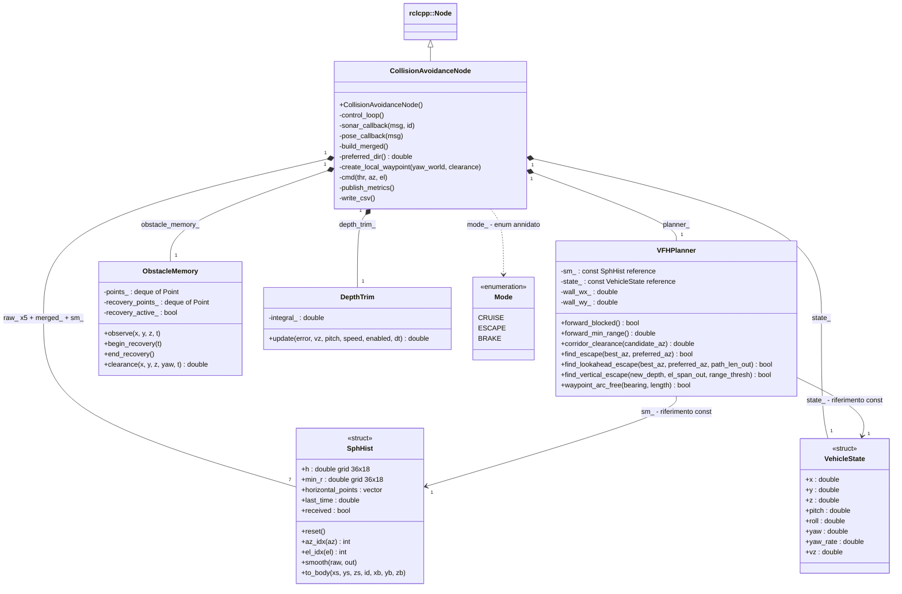

# UML del codice di collision avoidance

Diagramma ricavato dagli header e dal `CMakeLists.txt` del pacchetto `collision_avoidance`, nella versione del repository `4ce6b19`. Questa aggiunta modifica soltanto la documentazione, non il controllo o le simulazioni.

## Quale versione è pubblicata

Il codice principale è **già suddiviso in più file**. Sono inoltre presenti classi e strutture distinte per pianificazione, istogramma, stato, memoria degli ostacoli e correzione di quota.

La suddivisione in file non corrisponde però sempre a una classe per file: `sensors.cpp`, `navigation.cpp`, `motion_control.cpp` e `metrics.cpp` definiscono metodi di **CollisionAvoidanceNode**, dichiarati nello stesso header. Non esistono classi chiamate `Sensors`, `Navigation`, `MotionControl` o `Metrics` nella versione esaminata.

La copia monolitica in `progetto/sorgente_campagne_c7fd221cdb10/` è un archivio della versione delle campagne; non è quella selezionata dal `CMakeLists.txt` del pacchetto principale.

## Diagramma delle classi

Il diagramma mostra le responsabilità principali. Le firme sono abbreviate: tipi ROS, qualificatori, riferimenti dei parametri, valori predefiniti e numerosi membri di controllo sono omessi per leggibilità. Il codice rimane la fonte delle firme complete. In `SphHist`, gli indici, le trasformazioni e `smooth` sono funzioni statiche.

### Come leggere le relazioni

- Triangolo verso `rclcpp::Node`: ereditarietà; `CollisionAvoidanceNode` è un nodo ROS 2.
- Rombo pieno: composizione; il nodo possiede quei membri per valore.
- Freccia semplice dal planner: riferimenti non proprietari e `const`; il planner legge `sm_` e `state_`, posseduti dal nodo.
- I sette `SphHist` sono cinque istogrammi dei sensori, uno fuso e uno smussato. Non sono sette classi diverse.
- `Mode` è un enum privato annidato in `CollisionAvoidanceNode`, non una classe di controllo autonoma.

`ObstacleMemory` contiene anche il tipo privato annidato `Point` con `x`, `y`, `z`, `t`, usato dalle due code. È omesso dal disegno per mantenerlo leggibile.

## Suddivisione effettiva nei file

Tutti i percorsi della tabella sono relativi a [collision_avoidance](../../progetto/ros2_tethys/src/collision_avoidance/).

| File | Tipo o responsabilità |
|---|---|
| `src/main.cpp` | Inizializza ROS 2, crea il nodo e avvia `rclcpp::spin` |
| `include/collision_avoidance/collision_avoidance_node.hpp` | Dichiarazione di `CollisionAvoidanceNode`, membri ROS e stato del controllo |
| `src/collision_avoidance_node.cpp` | Costruttore e ciclo di controllo della stessa classe |
| `src/sensors.cpp` | Callback sonar e posa, fusione degli istogrammi della stessa classe |
| `src/navigation.cpp` | Direzioni preferite e waypoint della stessa classe |
| `src/motion_control.cpp` | Comandi al propulsore e alle pinne della stessa classe |
| `src/metrics.cpp` | Pubblicazione delle metriche e scrittura CSV della stessa classe |
| `include/collision_avoidance/vfh_planner.hpp`, `src/vfh_planner.cpp` | Classe separata `VFHPlanner` |
| `include/collision_avoidance/sph_hist.hpp` | Struct `SphHist` e funzioni per l'istogramma |
| `include/collision_avoidance/vehicle_state.hpp` | Struct `VehicleState` |
| `include/collision_avoidance/obstacle_memory.hpp` | Classe `ObstacleMemory` |
| `include/collision_avoidance/depth_controller.hpp` | Classe `DepthTrim` |
| `include/collision_avoidance/motion_safety.hpp` | Funzioni libere inline, non una classe |

Le funzioni libere di `motion_safety.hpp` sono `rear_stopping_distance`, `recovery_reverse_can_resume` e `recovery_thrust`. Non è stata inventata una classe UML per rappresentarle.

## Collegamento con le sei simulazioni

La struttura C++ è comune ai sei scenari. Nel caso multi-drone gli script avviano un nodo per veicolo; cambiano istanza, topic e parametri, non la struttura delle classi. I mondi SDF definiscono ambiente, sensori e dinamica e non sono classi C++ del nodo.

La funzione `find_vertical_escape` esiste nel planner, ma nei sei scenari finali l'opzione `allow_vertical_escape` è disabilitata. Il diagramma descrive il codice disponibile, non afferma che ogni funzionalità sia attiva in ogni prova.

## Sorgenti del diagramma

- [Mermaid modificabile](classi.mmd)
- [Header del nodo](../../progetto/ros2_tethys/src/collision_avoidance/include/collision_avoidance/collision_avoidance_node.hpp)
- [Header del planner](../../progetto/ros2_tethys/src/collision_avoidance/include/collision_avoidance/vfh_planner.hpp)
- [CMakeLists del pacchetto principale](../../progetto/ros2_tethys/src/collision_avoidance/CMakeLists.txt)

GitHub visualizza il blocco Mermaid direttamente in questa pagina.
