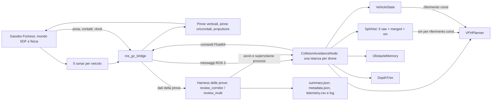

# Architettura e interfacce ROS 2

## Topic del controller

`D` indica il parametro `drone_name` (default `tethys`). I percorsi sono quelli costruiti dal costruttore; eventuali remapping dell'avvio possono cambiarli.

| Verso il nodo | Tipo ROS 2 | Uso |
|---|---|---|
| `/model/D/frontal_sonar/points` | `sensor_msgs/msg/PointCloud2` | Sonar frontale |
| `/model/D/left_sonar/points` | `sensor_msgs/msg/PointCloud2` | Sonar sinistro |
| `/model/D/right_sonar/points` | `sensor_msgs/msg/PointCloud2` | Sonar destro |
| `/model/D/bottom_sonar/points` | `sensor_msgs/msg/PointCloud2` | Sonar inferiore |
| `/model/D/top_sonar/points` | `sensor_msgs/msg/PointCloud2` | Sonar superiore |
| `/world/buoyant_tethys/dynamic_pose/info` | `tf2_msgs/msg/TFMessage` | Posa, orientamento e aggiornamento dello stato |
| `/model/D/contacts/L` | `ros_gz_interfaces/msg/Contacts` | Contatti sui sei link del veicolo |

`L`: `base_link`, `horizontal_fins`, `vertical_fins`, `propeller`, `buoyancy_engine`, `acoustic_transponder`. I sonar usano `SensorDataQoS`; posa e contatti sono creati con profondità 10.

| Dal nodo | Tipo ROS 2 | Uso |
|---|---|---|
| `/model/D/vertical_fins/cmd_pos` | `std_msgs/msg/Float64` | Posizione pinne verticali |
| `/model/D/horizontal_fins/cmd_pos` | `std_msgs/msg/Float64` | Posizione pinne orizzontali |
| `/model/D/joint/propeller_joint/cmd_thrust` | `std_msgs/msg/Float64` | Spinta del propulsore |
| `/ca_metrics` | `std_msgs/msg/String` | Metriche serializzate dal nodo |

## Tempi e istanze

- `control_loop`: timer di 200 ms sul clock del nodo, quindi 5 Hz simulati quando `use_sim_time` è attivo.
- `publish_metrics`: wall timer di 5000 ms, quindi ogni 5 secondi reali.
- `/clock` alimenta il tempo ROS quando si usa il tempo simulato; non è una sottoscrizione applicativa esplicita nell'header del controller.
- Il dato sonar è considerato vecchio oltre `SONAR_STALE = 1.5` secondi. Il controllo verifica anche freschezza della posa e presenza del sonar frontale.
- Prima della navigazione c'è un warmup di 2 secondi reali dal primo sonar.
- Nel caso multi-drone ci sono cinque istanze del controller: nessuna classe di coordinamento centrale è dichiarata nel pacchetto C++. L'harness supervisiona le prove e gli arrivi.
- `/ca_metrics` è assoluto e condiviso nel costruttore: non va confuso con cinque topic distinti automaticamente.

## Responsabilità dei dati

Il controller produce le proprie metriche e il CSV configurato da `csv_path`; l'harness produce riepiloghi e telemetria della campagna. `summary.json` non è scritto dal planner C++.

Fonti: [costruttore e controllo](../../progetto/ros2_tethys/src/collision_avoidance/src/collision_avoidance_node.cpp), [metriche](../../progetto/ros2_tethys/src/collision_avoidance/src/metrics.cpp), [harness multi-drone](../../progetto/ros2_tethys/scripts/review_multi.py). [Mermaid modificabile](architettura.mmd).
