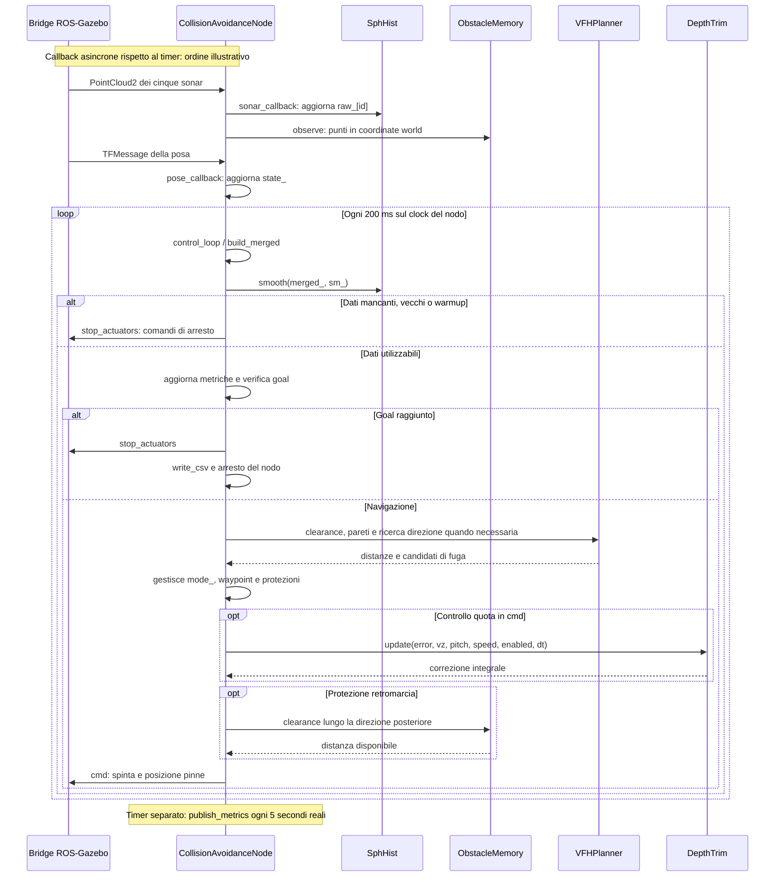

# Sequenza del controllo

Il diagramma descrive le responsabilità principali, non una traccia temporale di una specifica esecuzione. Callback e timer sono distinti; le protezioni possono produrre ritorni anticipati e non ogni tick invoca tutti i metodi del planner.

## Percezione e dati

1. `sonar_callback` converte i punti e aggiorna l'istogramma del sensore, i punti osservati e la memoria degli ostacoli.
2. `pose_callback` aggiorna `VehicleState` e le stime cinematiche.
3. `build_merged` ignora i sonar scaduti, somma le densità, prende le distanze minime e prepara i punti orizzontali rispetto alla posa attuale.
4. `SphHist::smooth` costruisce `sm_`, letto dal planner attraverso un riferimento const.

La griglia è 36 × 18 settori, con risoluzione angolare di 10°. Ogni cella conserva densità `h` e distanza minima `min_r`; i punti orizzontali mantengono informazioni geometriche più precise della sola quantizzazione.

## Pianificazione e attuazione

`VFHPlanner` valuta ingombro frontale, clearance dei corridoi, pareti, archi dei waypoint e vie di fuga. `CollisionAvoidanceNode` decide quale ramo usare, mantiene waypoint e stato e costruisce i comandi. `cmd` applica ulteriori protezioni, controllo quota, limiti e filtri prima di pubblicare.

`DepthTrim` conserva una correzione integrale limitata: integra soltanto se abilitato, velocità superiore a 0,4 m/s e intervallo valido, con anti-windup. `ObstacleMemory` conserva osservazioni per 30 s e uno snapshot durante il recupero; quest'ultimo viene liberato quando termina il recupero. Le funzioni libere di `motion_safety.hpp` supportano arresto e retromarcia: non sono classi.

La fuga verticale esiste nel codice ma è disabilitata nei sei scenari finali. Non va dedotta la sua attivazione dalla sola presenza del metodo `find_vertical_escape`.

Fonti: [sensori](../../progetto/ros2_tethys/src/collision_avoidance/src/sensors.cpp), [controllo](../../progetto/ros2_tethys/src/collision_avoidance/src/collision_avoidance_node.cpp), [attuazione](../../progetto/ros2_tethys/src/collision_avoidance/src/motion_control.cpp), [planner](../../progetto/ros2_tethys/src/collision_avoidance/src/vfh_planner.cpp). [Mermaid modificabile](sequenza.mmd).
