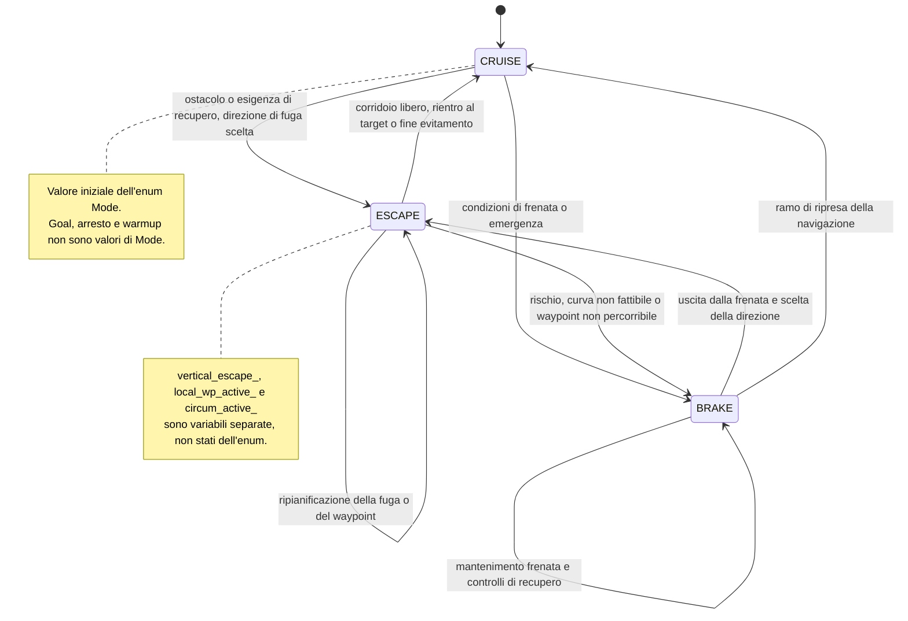

# Stati del controller

Il diagramma aggrega famiglie di transizioni e non attribuisce una singola soglia a tutti i rami. L'enum contiene solo tre valori; non è una macchina a stati gerarchica implementata da classi separate.

| Stato | Responsabilità |
|---|---|
| CRUISE | Navigazione verso il target o modalità wander, controllo direzione e quota |
| ESCAPE | Esecuzione e ripianificazione della direzione di fuga, eventuale waypoint locale |
| BRAKE | Frenata e recupero, controlli sullo spazio posteriore prima della retromarcia |

## Logiche trasversali

`stabilize_active_`, `alt_recovery_active_`, `circum_active_`, `final_approach_active_`, `vertical_escape_` e `local_wp_active_` sono flag con timer e condizioni proprie. Possono influenzare comandi o riassegnare `mode_`; non vanno disegnati come ulteriori valori dell'enum. Dati mancanti e warmup arrestano gli attuatori con ritorno anticipato; il raggiungimento del goal termina il controllo senza aggiungere uno stato `GOAL` all'enum.

## Tutte le assegnazioni esplicite nel ciclo di controllo

Indice estratto dal sorgente al commit `54a9355`. Il valore iniziale `CRUISE` è nell'header. Per ogni assegnazione, aprire il collegamento per leggere guardie, contesto ed effetti: la destinazione da sola non determina lo stato di partenza.

| Riga del sorgente | Stato assegnato |
|---|---|
| [319](../../progetto/ros2_tethys/src/collision_avoidance/src/collision_avoidance_node.cpp#L319) | `ESCAPE` |
| [326](../../progetto/ros2_tethys/src/collision_avoidance/src/collision_avoidance_node.cpp#L326) | `BRAKE` |
| [395](../../progetto/ros2_tethys/src/collision_avoidance/src/collision_avoidance_node.cpp#L395) | `ESCAPE` |
| [409](../../progetto/ros2_tethys/src/collision_avoidance/src/collision_avoidance_node.cpp#L409) | `CRUISE` |
| [602](../../progetto/ros2_tethys/src/collision_avoidance/src/collision_avoidance_node.cpp#L602) | `ESCAPE` |
| [720](../../progetto/ros2_tethys/src/collision_avoidance/src/collision_avoidance_node.cpp#L720) | `ESCAPE` |
| [777](../../progetto/ros2_tethys/src/collision_avoidance/src/collision_avoidance_node.cpp#L777) | `CRUISE` |
| [894](../../progetto/ros2_tethys/src/collision_avoidance/src/collision_avoidance_node.cpp#L894) | `BRAKE` |
| [913](../../progetto/ros2_tethys/src/collision_avoidance/src/collision_avoidance_node.cpp#L913) | `ESCAPE` |
| [1085](../../progetto/ros2_tethys/src/collision_avoidance/src/collision_avoidance_node.cpp#L1085) | `ESCAPE` |
| [1311](../../progetto/ros2_tethys/src/collision_avoidance/src/collision_avoidance_node.cpp#L1311) | `BRAKE` |
| [1340](../../progetto/ros2_tethys/src/collision_avoidance/src/collision_avoidance_node.cpp#L1340) | `ESCAPE` |
| [1369](../../progetto/ros2_tethys/src/collision_avoidance/src/collision_avoidance_node.cpp#L1369) | `BRAKE` |
| [1388](../../progetto/ros2_tethys/src/collision_avoidance/src/collision_avoidance_node.cpp#L1388) | `ESCAPE` |
| [1471](../../progetto/ros2_tethys/src/collision_avoidance/src/collision_avoidance_node.cpp#L1471) | `BRAKE` |
| [1590](../../progetto/ros2_tethys/src/collision_avoidance/src/collision_avoidance_node.cpp#L1590) | `ESCAPE` |
| [1602](../../progetto/ros2_tethys/src/collision_avoidance/src/collision_avoidance_node.cpp#L1602) | `CRUISE` |
| [1687](../../progetto/ros2_tethys/src/collision_avoidance/src/collision_avoidance_node.cpp#L1687) | `ESCAPE` |
| [1776](../../progetto/ros2_tethys/src/collision_avoidance/src/collision_avoidance_node.cpp#L1776) | `ESCAPE` |
| [1831](../../progetto/ros2_tethys/src/collision_avoidance/src/collision_avoidance_node.cpp#L1831) | `CRUISE` |
| [1853](../../progetto/ros2_tethys/src/collision_avoidance/src/collision_avoidance_node.cpp#L1853) | `CRUISE` |
| [1864](../../progetto/ros2_tethys/src/collision_avoidance/src/collision_avoidance_node.cpp#L1864) | `BRAKE` |
| [1916](../../progetto/ros2_tethys/src/collision_avoidance/src/collision_avoidance_node.cpp#L1916) | `BRAKE` |
| [1951](../../progetto/ros2_tethys/src/collision_avoidance/src/collision_avoidance_node.cpp#L1951) | `BRAKE` |
| [1973](../../progetto/ros2_tethys/src/collision_avoidance/src/collision_avoidance_node.cpp#L1973) | `BRAKE` |
| [2045](../../progetto/ros2_tethys/src/collision_avoidance/src/collision_avoidance_node.cpp#L2045) | `CRUISE` |
| [2095](../../progetto/ros2_tethys/src/collision_avoidance/src/collision_avoidance_node.cpp#L2095) | `CRUISE` |
| [2193](../../progetto/ros2_tethys/src/collision_avoidance/src/collision_avoidance_node.cpp#L2193) | `BRAKE` |

[Mermaid modificabile](stati.mmd).
